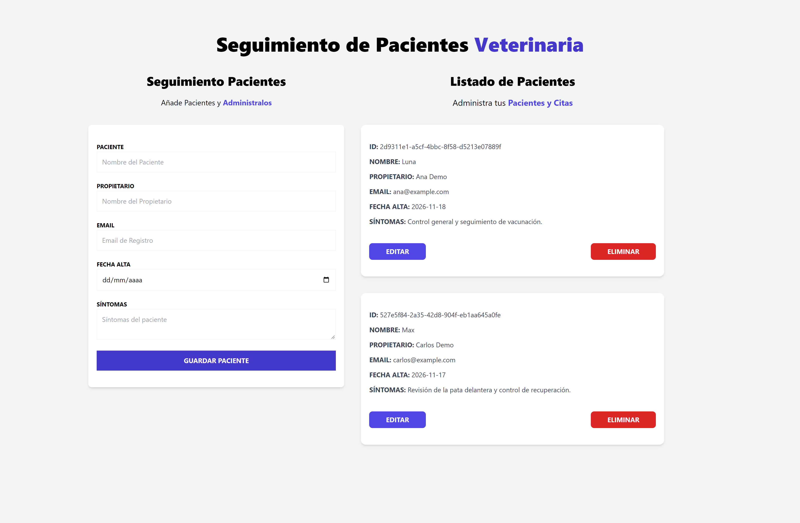

# AdminPacientes

Aplicación web para registrar y dar seguimiento a pacientes veterinarios. Reúne el formulario de alta, el listado y la edición de datos en una interfaz adaptable a escritorio y móvil.

Desarrollada con **React, TypeScript y Zustand**, con persistencia en el navegador y validación de formularios.



## Funcionalidades

- **Registro de pacientes:** nombre, propietario, correo electrónico, fecha de alta y síntomas.
- **Listado con detalles:** consulta de la información y el identificador de cada paciente.
- **Edición:** selección de un registro y carga de sus datos en el formulario.
- **Eliminación:** retiro de un paciente del listado.
- **Validación:** campos obligatorios y comprobación del formato del correo electrónico.
- **Persistencia local:** los registros se conservan al recargar la página.
- **Notificaciones:** confirmaciones al registrar, actualizar y eliminar.
- **Diseño responsive:** distribución en columnas en escritorio y vertical en móvil.

## Capturas reales

Capturas tomadas desde la aplicación ejecutándose en Chrome, con datos ficticios de demostración. Las imágenes de escritorio tienen un ancho de 3840 píxeles; la captura móvil, 780 píxeles.

| Vista | Captura |
| --- | --- |
| Formulario y estado inicial | [Ver imagen](docs/screenshots/01-seguimiento-pacientes-vista-inicial.png) |
| Listado y detalles | [Ver imagen](docs/screenshots/02-listado-y-detalles-de-pacientes.png) |
| Edición de un paciente | [Ver imagen](docs/screenshots/03-edicion-de-paciente.png) |
| Versión móvil | [Ver imagen](docs/screenshots/04-seguimiento-pacientes-vista-movil.png) |
| Mensajes de validación | [Ver imagen](docs/screenshots/05-validacion-del-formulario.png) |

## Tecnologías

| Tecnología | Uso |
| --- | --- |
| React 18 | Componentes e interfaz |
| TypeScript 5 | Tipado del modelo y del estado |
| Zustand 4 | Estado global y persistencia con `persist` |
| React Hook Form 7 | Gestión y validación del formulario |
| Tailwind CSS 3 | Estilos y diseño responsive |
| React Toastify 9 | Notificaciones de las operaciones |
| UUID 11 | Generación de identificadores |
| Vite 7 + SWC | Desarrollo y compilación |
| ESLint | Análisis estático del código |

Las versiones exactas están registradas en `package-lock.json`.

## Ejecutar en local

### Requisitos

- **Node.js 24 LTS**, recomendado y utilizado en la validación local.
- **npm**, incluido con Node.js.
- **Git**, para clonar el repositorio.

El requisito de Vite es Node.js `^20.19.0` o `>=22.12.0`.

### Instalación

```bash
git clone https://github.com/MaickR/AdminPacientes.git
cd AdminPacientes
npm ci
npm run dev -- --host 127.0.0.1 --port 5173 --strictPort
```

Abre **[http://127.0.0.1:5173/](http://127.0.0.1:5173/)** en el navegador. Para detener el servidor, presiona `Ctrl+C` en la terminal.

En Windows/PowerShell, si la política de ejecución bloquea `npm.ps1`, utiliza `npm.cmd` en lugar de `npm`, por ejemplo `npm.cmd ci`.

La aplicación funciona sin variables de entorno, servicios de backend ni base de datos externa.

## Uso

1. Completa los campos del formulario y pulsa **Guardar Paciente**.
2. Consulta el registro en **Listado de Pacientes**.
3. Pulsa **Editar** en una tarjeta, modifica los campos y vuelve a guardar.
4. Pulsa **Eliminar** para retirar un registro. La eliminación es inmediata y no dispone de deshacer.
5. Recarga la página para comprobar que los pacientes se conservan en el mismo navegador y origen.

El proyecto tiene una única página principal. El formulario, el estado vacío, el listado y la edición son estados de esa misma página.

## Comandos disponibles

| Comando | Descripción |
| --- | --- |
| `npm ci` | Instala las dependencias respetando el archivo de bloqueo |
| `npm run dev` | Inicia Vite con actualización automática |
| `npm run lint` | Verifica el código con ESLint, sin admitir advertencias |
| `npm run build` | Comprueba TypeScript y genera la aplicación en `dist/` |
| `npm run preview` | Sirve la compilación local; requiere compilar previamente |
| `npm audit` | Consulta las alertas conocidas de las dependencias |

Para revisar la compilación:

```bash
npm run build
npm run preview -- --host 127.0.0.1 --port 4173 --strictPort
```

Abre [http://127.0.0.1:4173/](http://127.0.0.1:4173/). `preview` permite comprobar el resultado localmente; la carpeta `dist/` es el artefacto para un alojamiento estático.

## Estructura del proyecto

```text
AdminPacientes/
├── .github/workflows/ci.yml       # Validación automática
├── docs/screenshots/             # Capturas reales
├── src/
│   ├── components/
│   │   ├── PatientForm.tsx        # Alta, edición y validación
│   │   ├── PatientsList.tsx       # Listado y estado vacío
│   │   ├── PatientDetails.tsx     # Tarjeta y acciones
│   │   ├── PatientDetailItem.tsx  # Presentación de un campo
│   │   └── Error.tsx             # Mensajes de validación
│   ├── types/index.ts            # Patient y DraftPatient
│   ├── store.ts                  # Operaciones y persistencia
│   ├── App.tsx                   # Composición de la página
│   ├── main.tsx                  # Entrada de React
│   └── index.css                 # Directivas de Tailwind
├── index.html
├── package.json
├── package-lock.json
├── tailwind.config.js
└── vite.config.ts
```

## Almacenamiento y alcance

Zustand guarda el estado en `localStorage` bajo la clave `patient-storage`. La fecha se conserva como una cadena `YYYY-MM-DD`, compatible con el formulario y la serialización JSON.

Los datos pertenecen al navegador y al origen utilizado: cambiar entre `localhost` y `127.0.0.1`, cambiar el puerto o utilizar otro navegador genera un almacenamiento independiente. Borrar los datos del sitio elimina los registros; la navegación privada puede descartarlos al cerrar la sesión.

Esta versión es una demostración frontend para portafolio. No incluye autenticación, roles, sincronización entre dispositivos, copias de seguridad, historial clínico ni calendario de citas. El uso con datos personales o clínicos reales requiere ampliar la solución con servicios y controles adecuados.

## Validación y mantenimiento

GitHub Actions ejecuta instalación reproducible, ESLint, compilación TypeScript/Vite y auditoría de dependencias en cada envío a `main` y en las solicitudes de cambio.

El recorrido de comprobación funcional comprende alta, persistencia tras recargar, edición, eliminación y validación de campos. Actualmente no se incluye una suite automatizada de pruebas funcionales en el repositorio.

## Créditos

Este repositorio conserva el historial del proyecto educativo [pacientes-zustand de Código con Juan](https://github.com/codigoconjuan/pacientes-zustand), utilizado como base. La preparación de esta versión incluye documentación, capturas de demostración, ajustes de calidad y actualización de dependencias.

No se ha añadido una licencia de distribución. Antes de reutilizar o redistribuir el código, revisa los permisos y las condiciones de su fuente original.
